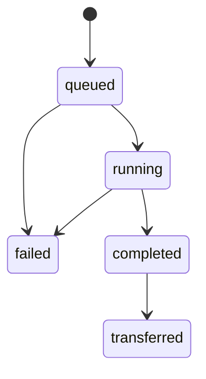

# Giao thức Agent

## 1. Phạm vi

Agent là API HTTP cục bộ trên endpoint Windows, cho phép máy điều tra gửi
`CollectionPlan` đã giới hạn, theo dõi task và tải Evidence Bundle. Phiên bản
giao thức hiện tại có base path:

```text
/api/v1
```

Agent không cung cấp endpoint thực thi command tùy ý, không nhận đường dẫn
output do client lựa chọn và không tự xác nhận incident.

## 2. Cấu hình và xác thực

Thiết lập được đọc từ `config/agent.json`. Khi authentication bật, mọi endpoint
phải có header token, mặc định:

```text
X-Agent-Token: <token từ biến môi trường>
```

Tên biến môi trường nằm tại `authentication.token_env`. Token không được lưu
trực tiếp trong file cấu hình trừ khi chế độ cấu hình cho phép rõ ràng; cấu hình
mặc định yêu cầu biến môi trường. Các entry point lab nạp `.env.lab` (mẫu
`config/lab.env.example`) trước khi tạo `AgentClient` hoặc chạy Agent.

Nếu HTTPS tắt, Agent chỉ được phép chạy khi `transport.lab_mode_only` là
`true`. `allowed_client_ips`, collector allowlist, giới hạn task, timeout, kích
thước file và bundle tiếp tục được áp dụng ở phía Agent.

## 3. Endpoint

| Method | Path | Thành công | Chức năng |
|---|---|---:|---|
| `GET` | `/api/v1/health` | `200` | Trạng thái Agent và số task |
| `POST` | `/api/v1/tasks` | `202` | Gửi Collection Plan |
| `GET` | `/api/v1/tasks/{task_id}` | `200` | Đọc trạng thái task |
| `GET` | `/api/v1/tasks/{task_id}/bundle` | `200` | Tải ZIP theo dạng binary stream |

Các endpoint JSON luôn trả object. Endpoint bundle trả
`Content-Type: application/zip`, không phải JSON hoặc UTF-8 text.

## 4. Kiểm tra sức khỏe

Request:

```text
GET /api/v1/health
X-Agent-Token: <token>
```

Response:

```json
{
  "status": "ok",
  "available": true,
  "agent_id": "WIN-LAB-AGENT",
  "task_counts": {
    "queued": 0,
    "running": 0,
    "completed": 2,
    "failed": 0
  }
}
```

Health check xác nhận API và danh tính Agent, không chứng minh mọi collector
đang có quyền đọc artifact.

## 5. Gửi Collection Plan

Request body có một object `collection_plan`:

```json
{
  "collection_plan": {
    "case_id": "CASE-20260729-001",
    "profile_id": "endpoint_compromise",
    "mode": "agent",
    "live_collectors": [
      "system",
      "processes",
      "network"
    ],
    "artifact_collectors": [
      "event_logs"
    ],
    "plan_id": "PLAN-11111111111111111111111111111111",
    "created_at": "2026-07-29T09:00:00.000Z",
    "time_range_start": "2026-07-28T09:00:00.000Z",
    "time_range_end": "2026-07-29T09:00:00.000Z",
    "target_agent_id": "WIN-LAB-AGENT",
    "options": {}
  }
}
```

Agent chỉ chấp nhận khi:

- `mode` là `agent`;
- `target_agent_id` khớp `agent.agent_id`;
- mọi collector nằm trong `collector_allowlist`;
- schema Collection Plan hợp lệ;
- số task `queued`/`running` chưa đạt `max_concurrent_tasks`.

Response `202` là snapshot đầu tiên của `AgentTask`:

```json
{
  "task_id": "TASK-11111111111111111111111111111111",
  "collection_plan": {
    "case_id": "CASE-20260729-001",
    "mode": "agent"
  },
  "status": "queued",
  "created_at": "2026-07-29T09:00:01.000Z",
  "started_at": null,
  "finished_at": null,
  "collection_results": [],
  "bundle_path": null,
  "bundle_sha256": null,
  "bundle_size_bytes": null,
  "bundle_available": false,
  "transferred_at": null,
  "error": ""
}
```

`collection_plan` trong response thực tế giữ toàn bộ plan đã chuẩn hóa.

## 6. Vòng đời task



`transferred` là trạng thái nghiệp vụ được biểu diễn bằng
`status: "completed"`, `transferred_at` khác null và có thể
`bundle_available: false` nếu chính sách xóa sau truyền được bật.

Client poll `GET /api/v1/tasks/{task_id}` cho tới `completed` hoặc `failed`.
Không nên poll nhanh hơn nhu cầu lab; `AgentClient` mặc định chờ một giây giữa
các lần kiểm tra.

Response task hoàn thành chứa SHA-256 và kết quả từng collector:

```json
{
  "task_id": "TASK-11111111111111111111111111111111",
  "collection_plan": {
    "case_id": "CASE-20260729-001",
    "mode": "agent"
  },
  "status": "completed",
  "created_at": "2026-07-29T09:00:01.000Z",
  "started_at": "2026-07-29T09:00:02.000Z",
  "finished_at": "2026-07-29T09:00:10.000Z",
  "collection_results": [
    {
      "collector_id": "system",
      "status": "succeeded",
      "record_count": 1
    }
  ],
  "bundle_path": "evidence_bundle.zip",
  "bundle_sha256": "bbbbbbbbbbbbbbbbbbbbbbbbbbbbbbbbbbbbbbbbbbbbbbbbbbbbbbbbbbbbbbbb",
  "bundle_size_bytes": 4096,
  "bundle_available": true,
  "transferred_at": null,
  "error": ""
}
```

## 7. Tải Evidence Bundle

Request:

```text
GET /api/v1/tasks/TASK-11111111111111111111111111111111/bundle
X-Agent-Token: <token>
```

Response có các header:

| Header | Ý nghĩa |
|---|---|
| `Content-Type` | `application/zip` |
| `Content-Disposition` | Tên file attachment theo task |
| `X-Content-SHA256` | SHA-256 của toàn bộ ZIP |
| `X-Agent-Task-ID` | Task tạo bundle |

Client phải:

1. đọc response dưới dạng bytes/stream, không gọi decode UTF-8;
2. ghi vào file tạm `.part`;
3. tính SHA-256 trong lúc ghi;
4. so sánh với hash từ task hoặc `X-Content-SHA256`;
5. chỉ đổi tên thành file đích khi hash khớp;
6. đóng response để callback Agent đánh dấu truyền thành công và giải phóng
   file handle trên Windows.

Nếu hash không khớp, client xóa file `.part` và không công bố bundle.

## 8. Mã lỗi

| HTTP | Trường hợp |
|---:|---|
| `400` | Body/Collection Plan không hợp lệ, sai mode/agent hoặc collector bị chặn |
| `401` | Thiếu hoặc sai token |
| `403` | IP client không nằm trong allowlist |
| `404` | Endpoint hoặc task không tồn tại |
| `405` | Sai HTTP method |
| `409` | Bundle chưa sẵn sàng/không còn khả dụng |
| `413` | Request body vượt giới hạn |
| `500` | Lỗi không xử lý được phía Agent |

JSON lỗi có dạng:

```json
{
  "error": "Thông báo lỗi đã được làm sạch"
}
```

Client không nên ghi token, Authorization header hoặc dữ liệu xác thực vào
log. Khi hiển thị lỗi response, nội dung phải được giới hạn độ dài.

## 9. Nội dung bundle do Agent tạo

```text
collection_plan.json
collection_results.json
acquisition/
├── live/
├── raw/
├── manifest.json
├── hashes.sha256
└── chain_of_custody.json
```

Manifest của Agent tối thiểu ghi `stored_path`, `sha256` và `size_bytes` cho
mỗi file acquisition. Sau khi tải, máy điều tra có thể dùng `BundleReader` để
kiểm tra ZIP và nhập dữ liệu vào Case.

## 10. Khuyến nghị triển khai

- Lab: bind `127.0.0.1` hoặc IP mạng host-only, bật token và snapshot VM.
- Mạng thật: bật HTTPS, firewall allowlist và quản lý token bên ngoài source.
- Chạy Agent bằng tài khoản tối thiểu đáp ứng artifact cần thu; không cấp quyền
  chỉ để bỏ qua lỗi.
- Đặt giới hạn file/bundle và thời gian lưu buffer theo dung lượng endpoint.
- Gọi `shutdown_app` khi test hoặc dừng Agent để đóng thread pool và
  `LocalClient`.
- Theo dõi `agent_audit.log`; không dùng log này thay cho chain of custody của
  evidence.
