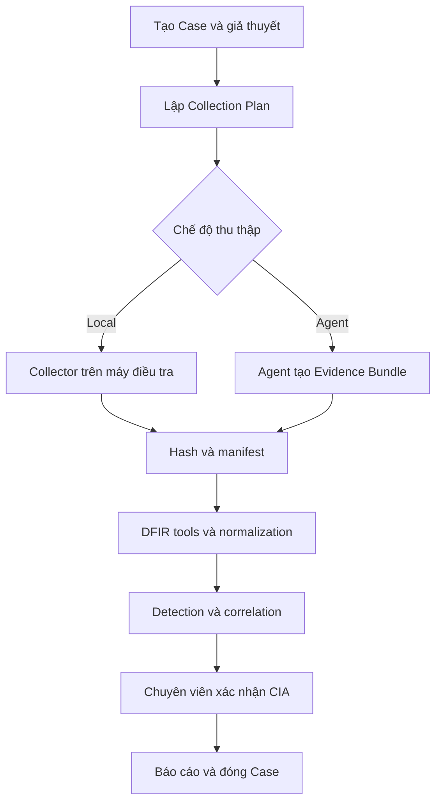

# Kiến trúc Windows Incident Analysis Toolkit

## 1. Mục đích và phạm vi

Windows Incident Analysis Toolkit hỗ trợ chuyên viên thu thập, bảo toàn, xử
lý và đối chiếu bằng chứng trên một máy Windows. Công cụ tổ chức mọi dữ liệu
theo `Case`, hỗ trợ thu thập trực tiếp bằng Local Mode hoặc thông qua Agent
Mode, sau đó chuẩn hóa dữ liệu, chạy luật phát hiện, tương quan các dấu hiệu và
xuất báo cáo.

Công cụ **không phải** SIEM/EDR, không giám sát liên tục toàn mạng, không tự
động ngăn chặn và không coi một alert đơn lẻ là sự cố đã được xác nhận. Kết quả
tự động chỉ tạo `Finding`, `Alert` và `Incident` ở trạng thái `suspected`.
Chuyên viên phải xem bằng chứng, kết luận trạng thái và xác nhận ảnh hưởng đến
Confidentiality, Integrity hoặc Availability.

## 2. Các lớp kiến trúc

| Lớp | Thư mục | Trách nhiệm |
|---|---|---|
| Entry point | `main.py`, `agent_main.py`, `dfir_cli.py` | Khởi động Dashboard, Agent API hoặc CLI |
| Giao diện | `ui/` | Điều phối thao tác Case, thu thập, phân tích và báo cáo |
| Quản lý vụ việc | `case_management/` | Tạo Case, cấu trúc thư mục, profile và audit log |
| Thu thập | `clients/`, `collection/`, `agent/` | Chạy collector ở máy điều tra hoặc endpoint |
| Bảo toàn bằng chứng | `evidence/` | SHA-256, manifest, chain of custody và Evidence Bundle |
| Tích hợp DFIR | `integrations/` | Kiểm tra executable, dựng lệnh, chạy tool và parse output |
| Xử lý | `processing/` | Chuẩn hóa timestamp/schema, loại trùng và xây timeline |
| Phân tích | `analysis/` | Analyzer, detection rule, risk scoring và correlation |
| Báo cáo | `reporting/` | Dựng ngữ cảnh và xuất HTML, PDF, JSON hoặc CSV |
| Mô hình dùng chung | `models/`, `common/`, `config/` | Kiểu dữ liệu, enum, tiện ích và cấu hình có phiên bản |

Các entry point chỉ gọi service công khai. UI không tự chạy PowerShell, rule
không đọc trực tiếp file EVTX và reporting không sửa dữ liệu phân tích. Sự
tách lớp này giúp kiểm thử từng phần và giữ bằng chứng gốc khỏi logic trình
bày.

## 3. Luồng xử lý tổng thể



Luồng chuẩn:

1. `CaseService` tạo `case.json`, `target.json`, `collection_plan.json` và cây
   thư mục riêng.
2. `CollectionService` đọc plan đã lưu, áp dụng mode/agent override hợp lệ rồi
   chạy các collector theo investigation profile.
3. Dữ liệu live được ghi vào `acquisition/live`; artifact được sao chép vào
   `acquisition/raw`.
4. `EvidenceService` và `ManifestBuilder` tính SHA-256, tạo manifest, danh sách
   hash và chain of custody.
5. Adapter chạy công cụ DFIR với input trong Case; parser chuyển output thành
   `NormalizedRecord`.
6. `ProcessingPipeline` chuẩn hóa, loại bản ghi trùng và xây timeline UTC.
7. `AnalysisService` tạo finding/alert, tính điểm rủi ro và tương quan thành
   incident nghi vấn.
8. Chuyên viên kiểm tra timeline và bằng chứng, sau đó cập nhật trạng thái,
   kết luận và tác động CIA.
9. `ReportService` xuất bản sao trình bày; báo cáo là dữ liệu dẫn xuất.

## 4. Local Mode và Agent Mode

### 4.1. Local Mode

`LocalClient` chạy PowerShell không qua shell trung gian. Collector thực thi
trên đúng máy đang chạy ứng dụng và ghi thẳng vào Case. Mode này phù hợp với
máy điều tra cục bộ, máy ảo lab hoặc khi chuyên viên có quyền truy cập trực
tiếp.

Ranh giới tin cậy:

- Collector chỉ được chọn từ `CollectorRegistry`.
- Quyền Administrator có thể cần cho Security Event Log, Registry hive,
  `$MFT`, memory và một số artifact bảo vệ.
- Thu thập live là ảnh chụp tại một thời điểm, không phải telemetry liên tục.

### 4.2. Agent Mode

Máy điều tra gửi một `CollectionPlan` có `mode: "agent"` tới endpoint đã đăng
ký. Agent kiểm tra token, `target_agent_id` và collector allowlist, thực thi
collector cục bộ rồi đóng gói dữ liệu. Máy điều tra tải ZIP theo dạng stream và
kiểm tra SHA-256 trước khi đưa vào Case.

Agent không nhận lệnh PowerShell tùy ý. Giao thức và trạng thái task được mô tả
trong [agent_protocol.md](agent_protocol.md).

## 5. Cấu trúc một Case

```text
runtime/cases/CASE-YYYYMMDD-NNN/
├── case.json
├── target.json
├── collection_plan.json
├── acquisition/
│   ├── live/
│   ├── raw/
│   ├── manifest.json
│   ├── hashes.sha256
│   └── chain_of_custody.json
├── bundles/
├── analysis/
│   ├── tool_outputs/
│   ├── normalized/
│   ├── findings.json
│   ├── alerts.json
│   ├── incidents.json
│   └── timeline.json
├── analyst/
│   ├── notes.json
│   ├── conclusion.json
│   └── recommendations.json
├── reports/
└── logs/
    ├── audit.log
    ├── collection.log
    ├── tool_runs.log
    └── errors.log
```

`acquisition/live` và `acquisition/raw` là đầu vào cần bảo toàn.
`analysis/tool_outputs`, `analysis/normalized`, alert, incident và report là dữ
liệu dẫn xuất có thể tạo lại nếu bằng chứng và cấu hình không đổi. Chi tiết
trường dữ liệu nằm trong [evidence_schema.md](evidence_schema.md).

## 6. Detection, correlation và quyết định của chuyên viên

- **Analyzer** tìm đặc điểm đáng chú ý trong từng nhóm artifact và tạo
  `Finding`.
- **Detection rule** áp dụng điều kiện cụ thể, ví dụ nhiều Event ID 4625 trong
  cửa sổ thời gian, rồi tạo `Alert` có severity, risk score, MITRE ATT&CK và
  khuyến nghị.
- **Correlation** liên kết nhiều alert/finding/timeline event theo thực thể và
  thời gian để dựng `Incident`.
- **Analyst decision** xác định incident là `confirmed`, `not_confirmed`,
  `false_positive` hoặc `closed`, kèm kết luận và tác động CIA.

Correlation không chỉ sắp xếp timeline. Timeline sắp bản ghi theo thời gian;
correlation kiểm tra quan hệ giữa các bản ghi, chẳng hạn chuỗi đăng nhập thất
bại rồi thành công từ cùng nguồn và cùng tài khoản.

## 7. Bất biến an toàn và toàn vẹn

1. Không ghi đè file trong `acquisition/raw`.
2. Mọi đường dẫn lưu trong JSON dùng dấu `/`, là đường dẫn tương đối và không
   chứa `..`.
3. Timestamp chuẩn dùng UTC ISO 8601, ví dụ `2026-07-29T08:05:00.000Z`.
4. SHA-256 được tính sau thu thập và được kiểm tra trước khi tái phân tích.
5. Executable tích hợp phải nằm trong `tools/`; tiến trình chạy với
   `shell=False`.
6. ZIP được kiểm tra path traversal, symbolic link, CRC, kích thước và tỷ lệ
   nén trước khi giải nén.
7. Token Agent không được ghi thẳng vào repository; token được lấy từ biến môi
   trường.
8. Demo chỉ chạy trong lab được phép, ưu tiên máy ảo có snapshot và dữ liệu
   tổng hợp.

## 8. Điểm mở rộng

- Thêm collector bằng cách đăng ký collector ID, category và output contract
  trong `CollectorRegistry`.
- Thêm tool bằng definition trong `config/tool_integrations.json`, một adapter
  và một parser tương ứng.
- Thêm rule bằng lớp kế thừa `BaseRule`, sau đó khai báo rule trong profile.
- Thêm correlation profile mà không thay đổi bằng chứng gốc.
- Thêm exporter mới thông qua `reporting/exporters/`.

Mỗi phần mở rộng phải có unit test, fixture an toàn và ít nhất một integration
test chứng minh dữ liệu đi qua đúng hợp đồng.
