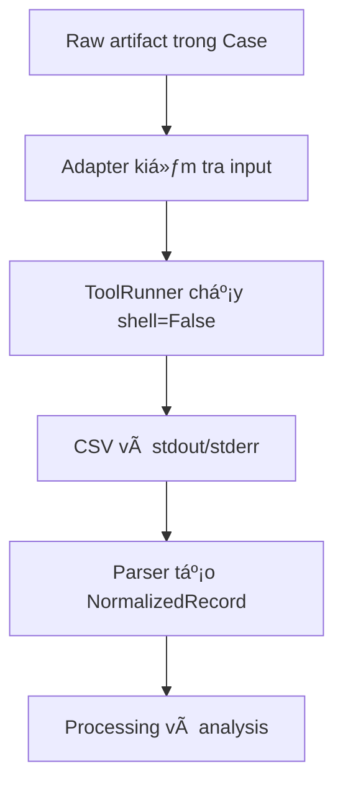

# Tích hợp công cụ DFIR

## 1. Mục tiêu

Thư mục `integrations/` bao bọc các công cụ DFIR bên ngoài bằng ba hợp đồng:

1. `ToolRegistry` đọc và kiểm tra definition trong
   `config/tool_integrations.json`;
2. adapter xây argument cố định từ input đã xác thực và gọi `ToolRunner`;
3. parser chuyển CSV/JSON/JSONL thành `NormalizedRecord`.

Executable không được commit vào Git. Người triển khai tự đặt binary hợp pháp
vào đúng vị trí dưới `tools/`.

## 2. Danh sách tích hợp

| Tool ID | Artifact | Adapter/parser | Output | Timeout | Vị trí executable |
|---|---|---|---|---:|---|
| `hayabusa` | `event_logs` | `hayabusa` | CSV | 300 s | `tools/Hayabusa/hayabusa.exe` |
| `evtxecmd` | `event_logs` | `evtxecmd` | CSV | 300 s | `tools/EZTools/net9/EvtxeCmd/EvtxECmd.exe` |
| `pecmd` | `prefetch` | `pecmd` | CSV | 180 s | `tools/EZTools/net9/PECmd.exe` |
| `amcacheparser` | `amcache` | `amcacheparser` | CSV | 180 s | `tools/EZTools/net9/AmcacheParser.exe` |
| `mftecmd` | `mft` | `mftecmd` | CSV | 300 s | `tools/EZTools/net9/MFTECmd.exe` |
| `recmd` | `registry` | `recmd` | CSV | 300 s | `tools/EZTools/net9/RECmd/RECmd.exe` |

Hayabusa và EvtxECmd là hai tool bắt buộc cho MVP theo cấu hình hiện tại. Các
tool còn lại phục vụ điều tra persistence và file-system artifact.

## 3. Definition cấu hình

Mỗi phần tử trong `tools` có schema:

```json
{
  "id": "evtxecmd",
  "name": "EvtxECmd",
  "enabled": true,
  "required_for_mvp": true,
  "adapter": "evtxecmd",
  "executable": "tools/EZTools/net9/EvtxeCmd/EvtxECmd.exe",
  "supported_artifacts": [
    "event_logs"
  ],
  "output_format": "csv",
  "timeout_seconds": 300
}
```

Quy tắc:

- `id` và `adapter` là chữ thường, bắt đầu bằng chữ cái;
- `executable` là đường dẫn tương đối an toàn bắt đầu bằng `tools/`;
- format chỉ là `csv`, `json` hoặc `jsonl`;
- `supported_artifacts` không rỗng và dùng giá trị `ArtifactType`;
- timeout là số dương;
- ID không được trùng;
- `enabled: false` ngăn tool chạy dù executable tồn tại.

## 4. Kiểm tra trước khi chạy

`ToolValidator` xác nhận:

- executable nằm dưới thư mục `tools/`;
- path tồn tại và là file;
- executable không phải symbolic link;
- trạng thái enable được phản ánh thành warning hoặc lỗi khi yêu cầu chạy.

Kiểm tra trong Python:

```python
from integrations.tool_registry import ToolRegistry
from integrations.tool_validator import ToolValidator

registry = ToolRegistry()
for result in ToolValidator(registry).validate_all():
    print(result.to_dict())
```

Thiếu binary là lỗi triển khai, không được khắc phục bằng cách thay executable
thành một đường dẫn ngoài `tools/`.

## 5. Luồng adapter và parser



Mỗi lần chạy có thư mục riêng:

```text
analysis/tool_outputs/<tool_id>/<run_id>/
├── <tool-output>.csv
├── stdout.txt
└── stderr.txt
```

`logs/tool_runs.log` ghi `ToolResult`, gồm command, thời gian, exit code,
status, output file và lỗi rút gọn. Output phải nằm trong run directory; symlink
và output thoát khỏi Case bị từ chối.

## 6. Hợp đồng input và lệnh

| Tool | Input | Argument chính do adapter dựng |
|---|---|---|
| Hayabusa | Một thư mục EVTX | `csv-timeline -d <dir> -o <csv> --UTC` |
| EvtxECmd | Một file hoặc thư mục EVTX | `-f/-d <input> --csv <dir> --csvf evtxecmd.csv` |
| PECmd | Một file hoặc thư mục Prefetch | `-f/-d <input> --csv <dir> --csvf pecmd.csv` |
| AmcacheParser | Má»™t file `Amcache.hve` | `-f <file> --csv <dir> --csvf amcache.csv` |
| MFTECmd | Má»™t file `$MFT` | `-f <file> --csv <dir> --csvf mftecmd.csv` |
| RECmd | Một file hoặc thư mục Registry hive | `-f/-d <input> --csv <dir> --csvf recmd.csv` |

Adapter nhận đường dẫn đã resolve, không nhận chuỗi command hoàn chỉnh từ UI.
`ToolRunner` gọi `subprocess.run` với `shell=False`, timeout theo definition và
decode output bằng UTF-8 với ký tự lỗi được thay thế.

## 7. Ánh xạ parser

| Parser | `source_type` | Timestamp ưu tiên | Thực thể chính |
|---|---|---|---|
| Hayabusa | `hayabusa_event` | Timestamp/Datetime/TimeCreated | event, user, process, IP |
| EvtxECmd | `evtxecmd_event` | TimeCreated/Timestamp/DateTime | event ID, user, process ID |
| PECmd | `pecmd_prefetch` | LastRun/LastRun0/SourceCreated | executable, file path |
| AmcacheParser | `amcacheparser_file` | file/key last-write | program/file path |
| MFTECmd | `mftecmd_file` | MFT modified/created | file path |
| RECmd | `recmd_registry` | Registry last-write | key/value path |

Parser giữ toàn bộ row nguồn trong `attributes`, đồng thời chọn các trường
chung cho detection và correlation. `raw_reference` luôn trỏ về output tương
đối trong Case.

## 8. Quan hệ với investigation profile

| Profile | Tool chính |
|---|---|
| `account_compromise` | Hayabusa, EvtxECmd |
| `endpoint_compromise` | Hayabusa, EvtxECmd, PECmd, AmcacheParser, MFTECmd, RECmd |
| `log_tampering` | Hayabusa, EvtxECmd, PECmd |
| `service_disruption` | Hayabusa, EvtxECmd, RECmd, PECmd |
| `general_investigation` | Hayabusa, EvtxECmd, PECmd, AmcacheParser, RECmd |

Tool trong profile mô tả pipeline mong muốn; `ToolValidator` vẫn phải xác nhận
binary tại thời gian chạy.

## 9. Thêm một tích hợp mới

1. Thêm definition có `schema_version` tương thích vào
   `config/tool_integrations.json`.
2. Tạo adapter kế thừa `BaseAdapter`; cố định artifact type, kiểm tra input và
   output glob.
3. Tạo parser kế thừa `BaseParser`; ánh xạ row sang `NormalizedRecord`.
4. Đăng ký adapter/parser tại nơi điều phối tích hợp.
5. Thêm fixture nhỏ, vô hại; không commit artifact nhạy cảm hay binary.
6. Viết test cho definition, command, timeout, path traversal, parse row và
   workflow end-to-end.
7. Cập nhật investigation profile và tài liệu này.

## 10. Xử lý lỗi

- Exit code khác `0`: `ToolRunStatus.FAILED`.
- Vượt timeout: `ToolRunStatus.TIMED_OUT`.
- Không tạo output khớp glob: thất bại dù exit code bằng `0`.
- stdout/stderr luôn được lưu để điều tra lỗi, nhưng không thay thế evidence.
- Parser từ chối file format không hỗ trợ hoặc timestamp bắt buộc bị thiếu.
- Một tool thất bại không làm thay đổi hash của raw artifact.

