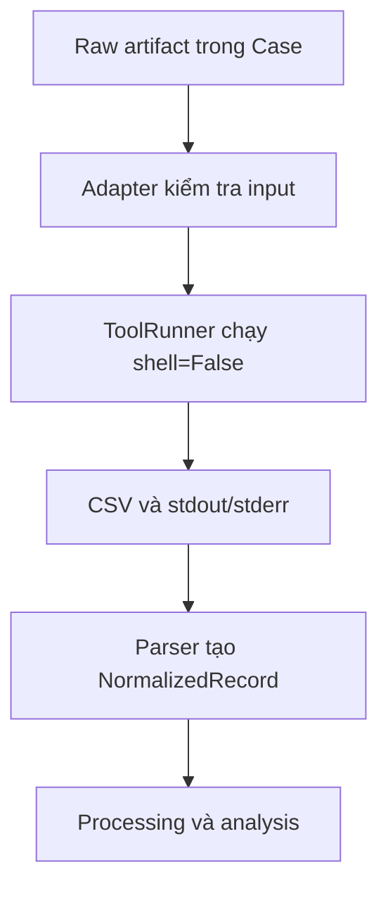

# Tích hợp công cụ DFIR

## 1. Mục tiêu

Thư mục `integrations/` bao bọc các công cụ DFIR bên ngoài bằng ba hợp đồng:

1. `ToolRegistry` đọc và kiểm tra definition trong
   `config/tool_integrations.json`;
2. adapter xây argument cố định từ input đã xác thực và gọi `ToolRunner`;
3. parser chuyển CSV/JSON/JSONL thành `NormalizedRecord`.

Executable không được commit vào Git. Người triển khai tự đặt binary hợp pháp
vào đúng vị trí dưới `tools/`. Dashboard tab Overview hiện trạng thái
thiếu/đủ của từng tool trước khi demo.

## 2. Danh sách tích hợp

| Tool ID | Artifact | Adapter/parser | Output | Timeout | Vị trí executable |
|---|---|---|---|---:|---|
| `hayabusa` | `event_logs` | `hayabusa` | CSV | 300 s | `tools/Hayabusa/hayabusa.exe` |
| `evtxecmd` | `event_logs` | `evtxecmd` | CSV | 300 s | `tools/EZTools/net9/EvtxeCmd/EvtxECmd.exe` |
| `pecmd` | `prefetch` | `pecmd` | CSV | 180 s | `tools/EZTools/net9/PECmd.exe` |
| `amcacheparser` | `amcache` | `amcacheparser` | CSV | 180 s | `tools/EZTools/net9/AmcacheParser.exe` |
| `mftecmd` | `mft` | `mftecmd` | CSV | 300 s | `tools/EZTools/net9/MFTECmd.exe` |
| `recmd` | `registry` | `recmd` | CSV | 300 s | `tools/EZTools/net9/RECmd/RECmd.exe` |

Hayabusa và EvtxECmd là hai tool bắt buộc cho MVP theo cấu hình hiện tại. Các
tool còn lại phục vụ điều tra persistence và file-system artifact.

## 3. Definition cấu hình

Mỗi phần tử trong `tools` có schema:

```json
{
  "id": "evtxecmd",
  "name": "EvtxECmd",
  "enabled": true,
  "required_for_mvp": true,
  "adapter": "evtxecmd",
  "executable": "tools/EZTools/net9/EvtxeCmd/EvtxECmd.exe",
  "supported_artifacts": [
    "event_logs"
  ],
  "output_format": "csv",
  "timeout_seconds": 300
}
```

Quy tắc:

- `id` và `adapter` là chữ thường, bắt đầu bằng chữ cái;
- `executable` là đường dẫn tương đối an toàn bắt đầu bằng `tools/`;
- format chỉ là `csv`, `json` hoặc `jsonl`;
- `supported_artifacts` không rỗng và dùng giá trị `ArtifactType`;
- timeout là số dương;
- ID không được trùng;
- `enabled: false` ngăn tool chạy dù executable tồn tại.

## 4. Kiểm tra trước khi chạy

`ToolValidator` xác nhận:

- executable nằm dưới thư mục `tools/`;
- path tồn tại và là file;
- executable không phải symbolic link;
- trạng thái enable được phản ánh thành warning hoặc lỗi khi yêu cầu chạy.

Kiểm tra trong Python:

```python
from integrations.tool_registry import ToolRegistry
from integrations.tool_validator import ToolValidator

registry = ToolRegistry()
for result in ToolValidator(registry).validate_all():
    print(result.to_dict())
```

Thiếu binary là lỗi triển khai, không được khắc phục bằng cách thay executable
thành một đường dẫn ngoài `tools/`.

## 5. Luồng adapter và parser



Mỗi lần chạy có thư mục riêng:

```text
analysis/tool_outputs/<tool_id>/<run_id>/
├── <tool-output>.csv
├── stdout.txt
└── stderr.txt
```

`logs/tool_runs.log` ghi `ToolResult`, gồm command, thời gian, exit code,
status, output file và lỗi rút gọn. Output phải nằm trong run directory; symlink
và output thoát khỏi Case bị từ chối.

## 6. Hợp đồng input và lệnh

| Tool | Input | Argument chính do adapter dựng |
|---|---|---|
| Hayabusa | Một thư mục EVTX | `csv-timeline -d <dir> -o <csv> --UTC --no-wizard --no-color --profile verbose` |
| EvtxECmd | Một file hoặc thư mục EVTX | `-f/-d <input> --csv <dir> --csvf evtxecmd.csv` |
| PECmd | Một file hoặc thư mục Prefetch | `-f/-d <input> --csv <dir> --csvf pecmd.csv` |
| AmcacheParser | Một file `Amcache.hve` | `-f <file> --csv <dir> --csvf amcache.csv` |
| MFTECmd | Một file `$MFT` | `-f <file> --csv <dir> --csvf mftecmd.csv` |
| RECmd | Một file hoặc thư mục Registry hive | `-f/-d <input> --csv <dir> --csvf recmd.csv` |

Adapter nhận đường dẫn đã resolve, không nhận chuỗi command hoàn chỉnh từ UI.
`ToolRunner` gọi `subprocess.run` với `shell=False`, timeout theo definition và
decode output bằng UTF-8 với ký tự lỗi được thay thế.

Hayabusa được gọi với `--no-wizard` để bỏ qua Scan Wizard: quá trình chạy từ
giao diện không có terminal để trả lời câu hỏi tương tác. `--no-color` tắt màu
terminal trong nhật ký. Profile `verbose` giữ `RecordID`, `EvtxFile` và
`ExtraFieldInfo` để đối chiếu cùng sự kiện giữa các công cụ. Giữ đầy đủ thư mục
cài đặt Hayabusa cùng các file rules
và cấu hình đi kèm executable.

## 7. Ánh xạ parser

| Parser | `source_type` | Timestamp ưu tiên | Thực thể chính |
|---|---|---|---|
| Hayabusa | `hayabusa_event` | Timestamp/Datetime/TimeCreated | event, user, process, IP |
| EvtxECmd | `evtxecmd_event` | TimeCreated/Timestamp/DateTime | event ID, tài khoản đích, IP, process |
| PECmd | `pecmd_prefetch` | LastRun/LastRun0/SourceCreated | executable, file path |
| AmcacheParser | `amcacheparser_file` | file/key last-write | program/file path |
| MFTECmd | `mftecmd_file` | MFT modified/created | file path |
| RECmd | `recmd_registry` | Registry last-write | key/value path |

Parser giữ toàn bộ row nguồn trong `attributes`, đồng thời chọn các trường
chung cho detection và correlation. `raw_reference` luôn trỏ về output tương
đối trong Case.

Parser Hayabusa chấp nhận ISO-8601 và định dạng có khoảng trắng trước offset,
ví dụ `2026-10-07 16:25:43.932 +00:00`. Offset được dùng để quy đổi về UTC;
chuỗi timestamp gốc vẫn nằm trong `attributes`. Timestamp sai vẫn báo lỗi
kèm số record, không được thay bằng thời điểm chạy tool.

EvtxECmd `Payload` có thể chứa JSON `EventData.Data` với các cặp `@Name`/`#text`
(hoặc `@name`), hoặc `UserData`. Parser đọc các trường có tên này; các cột
`MapDescription`/`Description` được ưu tiên làm tóm tắt, không hiển thị JSON
thô trong ô tóm tắt. Hayabusa hỗ trợ object JSON và text `Tên: giá trị` phân
tách bằng ` ¦ ` hoặc ` | ` trong `Details`, `ExtraFieldInfo`, `AllFieldInfo`.
IPv6, đường dẫn Windows và dấu hai chấm trong command line được giữ nguyên.
CSV có ô nhiều dòng được đọc bằng CSV reader, không nối mất dấu xuống dòng.

4624/4625 ưu tiên `TargetUserName`/`TgtUser` và domain đích, không thay bằng
`SubjectUserName` hay SID `UserId`. `LogonType`/`Type` và IP hợp lệ được thêm
vào các trường chuẩn hóa; `-`/`n/a` không được coi là thực thể. IP không có
trong dữ liệu sẽ để trống. Các cột gốc vẫn giữ nguyên trong `attributes`, cùng
các trường bổ sung `target_user`, `source_ip`, `logon_type`, `event_record_id`,
`channel`, `source_event_file` và `command_line` khi có.

Timeline giữ từng dòng từ công cụ, hiển thị cột Nguồn. Với hai luật đăng nhập,
các dòng chỉ được tính là cùng một sự kiện khi có cùng Case, hostname, channel,
file EVTX, Event ID, RecordID dương và timestamp ở độ chính xác millisecond.
Thiếu thông tin nhận diện thì không gộp chỉ dựa vào timestamp. `failure_count`
dùng số sự kiện sau đối chiếu, `source_record_count` cho biết số dòng công cụ;
Alert giữ đủ `source_record_ids`. Tương quan đăng nhập thành công sau thất bại
yêu cầu tài khoản, IP và hostname rõ ràng. Một 4625 riêng lẻ không xác nhận RDP.

## 8. Quan hệ với investigation profile

| Profile | Tool chính |
|---|---|
| `account_compromise` | Hayabusa, EvtxECmd |
| `endpoint_compromise` | Hayabusa, EvtxECmd, PECmd, AmcacheParser, MFTECmd, RECmd |
| `log_tampering` | Hayabusa, EvtxECmd, PECmd |
| `service_disruption` | Hayabusa, EvtxECmd, RECmd, PECmd |
| `general_investigation` | Hayabusa, EvtxECmd, PECmd, AmcacheParser, RECmd |

Tool trong profile mô tả pipeline mong muốn; `ToolValidator` vẫn phải xác nhận
binary tại thời gian chạy.

## 9. Thêm một tích hợp mới

1. Thêm definition có `schema_version` tương thích vào
   `config/tool_integrations.json`.
2. Tạo adapter kế thừa `BaseAdapter`; cố định artifact type, kiểm tra input và
   output glob.
3. Tạo parser kế thừa `BaseParser`; ánh xạ row sang `NormalizedRecord`.
4. Đăng ký adapter/parser tại nơi điều phối tích hợp.
5. Thêm fixture nhỏ, vô hại; không commit artifact nhạy cảm hay binary.
6. Viết test cho definition, command, timeout, path traversal, parse row và
   workflow end-to-end.
7. Cập nhật investigation profile và tài liệu này.

## 10. Xử lý lỗi

- Exit code khác `0`: `ToolRunStatus.FAILED`.
- Vượt timeout: `ToolRunStatus.TIMED_OUT`.
- Không tạo output khớp glob: thất bại dù exit code bằng `0`.
- stdout/stderr luôn được lưu để điều tra lỗi, nhưng không thay thế evidence.
- Parser từ chối file format không hỗ trợ hoặc timestamp bắt buộc bị thiếu.
- Một tool thất bại không làm thay đổi hash của raw artifact.

Nếu bản cũ báo Hayabusa `not a terminal`, đóng Crow-Eye, cập nhật
`integrations/adapters/hayabusa_adapter.py`, mở lại ứng dụng và chạy lại
**1. Xử lý dữ liệu thô**. Sau khi Hayabusa thành công, chạy **2. Chạy phân tích**
để cập nhật kết quả. Kiểm tra các cảnh báo còn lại trong hộp thoại và file
`stderr.txt` của từng tool; xử lý hoàn tất không có nghĩa mọi tool đều thành công.
